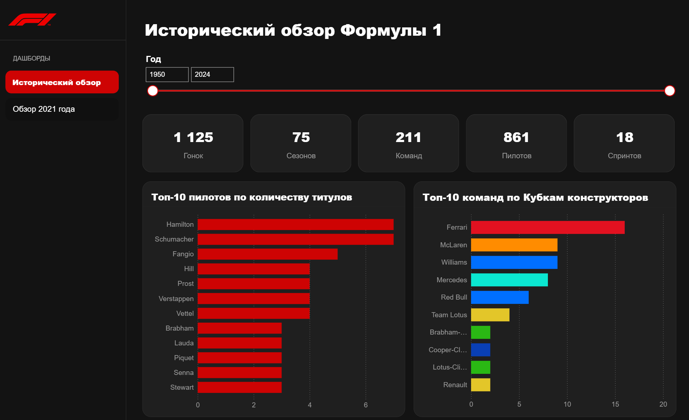
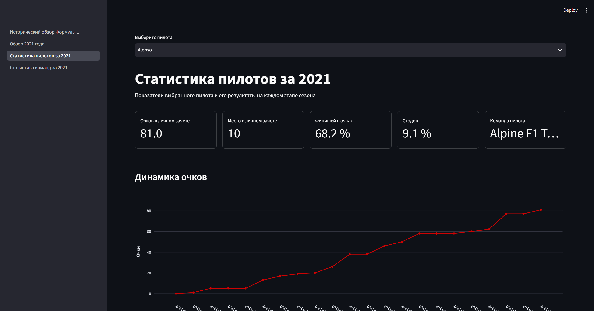

# Formula-1 Dashboard

Интерактивный дашборд для анализа истории Формулы‑1 и результатов сезона 2021 года.

Проект реализован в двух версиях: **Power BI** и **Python**.
Обе используют общую базу данных **SQLite**, подготовленную из открытого датасета Kaggle.

## О проекте

Дашборд позволяет исследовать историю чемпионата, сравнивать пилотов
и команды, просматривать итоги сезона и результаты отдельных Гран-при.

Цель проекта: попробовать разные подходы к визуализации данных и созданию интерактивных дашбордов в Power BI и Python.

В Power BI используются Power Query и DAX.
В Python версии расчёты выполняются через SQL, графики строятся
с помощью Plotly, а интерфейс с помощью Streamlit.

## Разделы дашборда

### Исторический обзор Формулы‑1

Количество гонок, спринтов, пилотов и команд за выбранный период.
Топ-10 пилотов и команд по числу чемпионских титулов.

### Обзор сезона 2021

Победители чемпионата, личный зачёт и Кубок конструкторов,
динамика очков и география Гран-при.

### Детализация по пилотам

Результаты выбранного пилота: очки, место в чемпионате,
победы, подиумы, показатели квалификаций и гонок,
а также таблица результатов по этапам.

### Детализация по командам

Результаты выбранной команды: положение в Кубке конструкторов,
очки, вклад пилотов, динамика очков и показатели выступлений.

## Версии проекта

| Версия | Основные инструменты | Инструкция                     |
|---|---|--------------------------------|
| Power BI | Power Query, DAX, SQLite через ODBC | [Power BI](power_bi/README.md) |
| Python | SQL, pandas, Plotly, Streamlit | [Python](python/README.md)     |

## Данные

Источник: [Formula 1 World Championship на Kaggle](https://www.kaggle.com/datasets/rohanrao/formula-1-world-championship-1950-2020).

Используемый набор данных охватывает период 1950–2024 годов.
Исторический раздел работает с этим периодом,
детальный анализ посвящён сезону 2021 года.

В проект включены:

- `database/source_csv.zip` — исходные CSV;
- `database/f1.db` — готовая база SQLite;
- код создания таблиц и загрузки данных.

Для работы дашбордов используется готовая база.
Повторно собирать её перед запуском не требуется.

## Структура проекта

    formula-1-dashboard/
    ├── README.md
    ├── database/
    │   ├── f1.db
    │   ├── source_csv.zip
    │   ├── schema.py
    │   ├── fill_database.py
    │   └── build_database.py
    ├── power_bi/
    ├── python/
    └── docs/

## Примеры

### Power BI

### Python

## Что было сделано

- Изучены исходные данные и связи между таблицами.
- Создана общая база SQLite и реализована загрузка данных из CSV.
- Разработаны SQL-запросы для расчёта аналитических показателей.
- Построена модель данных и созданы меры DAX в Power BI.
- Реализована Python-версия дашборда на Streamlit и Plotly.
- Спроектированы страницы, фильтры и визуализации.
- Подготовлена документация проекта.

## Особенности данных

### Результаты гонок и положение в чемпионате

Таблица `results` содержит результаты пилотов в отдельных гонках:
позицию, начисленные за гонку очки и другие показатели выступления.

Таблицы `driver_standings` и `constructor_standings` содержат
положение пилотов и команд в чемпионате после каждого этапа.
Поля `points` и `wins` отражают накопленные очки и победы,
а `position` место в общем зачёте после соответствующего этапа.

### Поля позиции в results

- `position` — числовая итоговая позиция пилота. Может быть `NULL`,
  если числовая позиция не присвоена.
- `positionText` — текстовое обозначение результата: позиция
  или специальный код, например `R` — retired.
- `positionOrder` — числовой порядок результатов, включая записи
  без числовой позиции в `position`.

### Чемпионские титулы

Чемпионские титулы определяются по первому месту в зачёте
после последнего этапа завершённого сезона.

### Начисление очков

Правила начисления очков менялись на протяжении истории чемпионата.
Поэтому финиш в топ-10 и получение очков не равнозначны
для всех сезонов.

### Актуальность данных

Используется фиксированный набор данных.
Автоматическое обновление результатов новых гонок не предусмотрено.